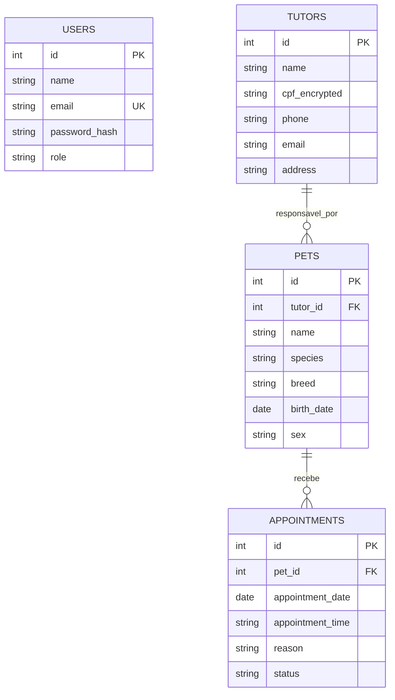

# Vetora Clínica

Sistema local para organizar tutores, pets e atendimentos de uma clínica veterinária. Implementado em Node.js e SQLite, sem dependências npm externas.

## Executar

Requisitos: Node.js 22.9 ou superior.

1. Na pasta do projeto, gere uma chave exclusiva e grave a configuração local:

    ```sh
    npm run setup
   ```

2. Inicie o sistema:

   ```powershell
   npm start
   ```

3. Acesse <http://localhost:3000>.

O banco `data/clinicavet.sqlite` e os dados iniciais são criados automaticamente na primeira execução. Para rodar os testes: `npm test`.

### Acesso de demonstração

| Usuário | E-mail | Senha |
| --- | --- | --- |
| João (admin) | `joao@gmail.com` | `Vet@2026` |
| Rafael Lima (atendente) | `rafael@clinicavet.local` | `Vet@2026!` |
| Camila Souza (atendente) | `camila@clinicavet.local` | `Vet@2026!` |

As credenciais e os dados são exclusivamente para demonstração; altere-os antes de qualquer uso real.

## Requisitos funcionais

| ID | Requisito | Implementação |
| --- | --- | --- |
| RF01 | Autenticar usuários e informar falhas de acesso. | Login por e-mail e senha com mensagem genérica para credenciais inválidas e bloqueio temporário após cinco falhas. |
| RF02 | Expirar a autenticação por inatividade e permitir saída. | Sessão individual com expiração deslizante de 30 minutos, cookie `HttpOnly` e ação de logout. |
| RF03 | Exibir usuário autenticado e acesso aos recursos. | Início com nome do usuário, indicadores e navegação para tutores, pets e agenda. |
| RF04 | Pesquisar tutores por termo informado. | Busca confirmada por nome, CPF, telefone, e-mail ou endereço; lista atualizada após o envio. |
| RF05 | Cadastrar e editar tutores, persistindo as alterações. | Formulário de cadastro e edição na listagem; CPF válido e único. |
| RF06 | Cadastrar pets associados a um tutor existente. | Seleção obrigatória de tutor no formulário do pet e chave estrangeira no banco. |
| RF07 | Consultar agendamentos em ordem cronológica com dados do pet e tutor. | Agenda ordenada por data e horário; exibe paciente, tutor e dados de contato. |
| RF08 | Criar agendamentos e atualizar sua data/horário. | Formulário de agendamento e ação de edição persistida na listagem. |
| RF09 | Iniciar com ao menos três registros em cada tabela. | Bootstrap em `database.js` insere três usuários, tutores, pets e agendamentos em banco vazio. |

## Requisitos não funcionais e proteção de dados

- CPF é cifrado em repouso com AES-256-GCM; a chave fica no `.env`, fora do banco e do controle de versão. Na listagem, o CPF aparece mascarado.
- Senhas são armazenadas com `scrypt` e salt aleatório por usuário; a comparação usa tempo constante.
- As consultas ao SQLite usam parâmetros. Os formulários têm token CSRF; saídas HTML são escapadas e a resposta inclui políticas básicas de segurança.
- O banco ativa chaves estrangeiras e usa modo WAL. A aplicação local escuta somente em `127.0.0.1` por padrão.
- A chave de cifragem deve ser mantida em backup seguro. Se perdida, os CPFs já cifrados não poderão ser recuperados. Não use a chave de exemplo/demonstração em produção.
- As medidas técnicas deste protótipo não garantem, isoladamente, conformidade integral à LGPD. Uma implantação real também exige controles de acesso, gestão de chaves, backups protegidos, política de retenção, resposta a incidentes e revisão jurídica/organizacional.

## Modelo de dados (DER)



## Estrutura

- `server.js`: servidor HTTP, sessão e rotas de tela/formulário.
- `database.js`: esquema SQLite, chaves estrangeiras, índices e carga inicial.
- `security.js`: cifra do CPF, validação/máscara e hash de senha.
- `public/style.css`: interface responsiva.
- `test/database.test.js`: testes de cifra, validação de CPF, senha, carga inicial e integridade referencial.